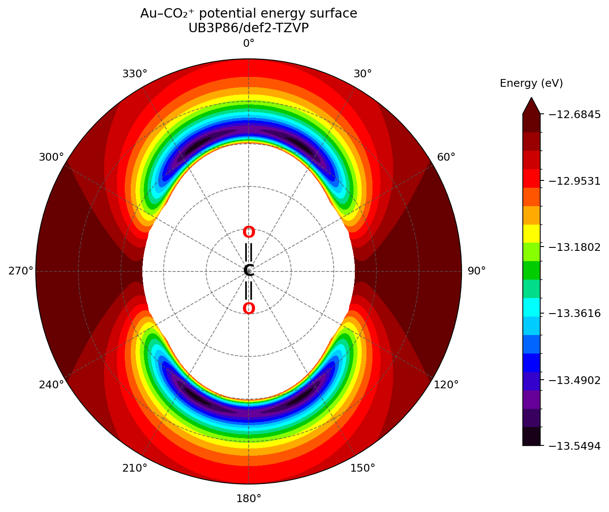
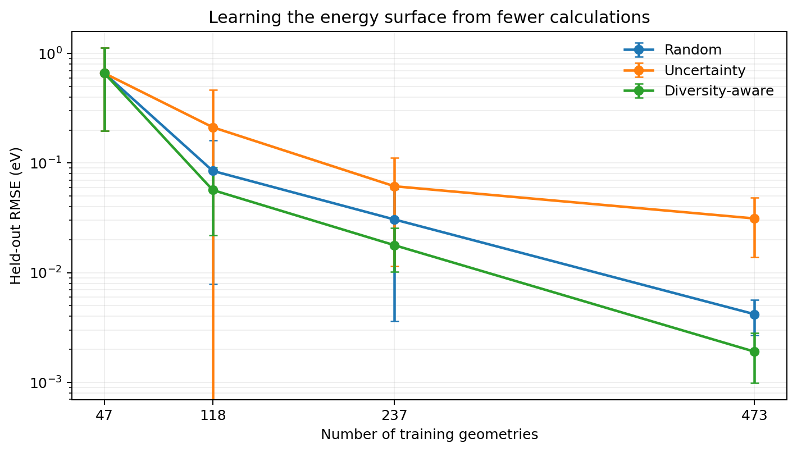
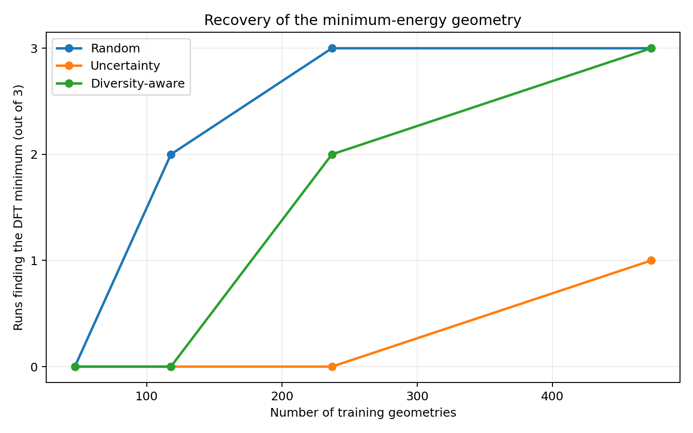

# Learning the Au–CO₂⁺ potential energy surface with Gaussian Process Regression

Can a molecular potential energy surface be reproduced using fewer electronic-structure calculations, and does the choice of training geometries matter?

## Overview

I ran 2,366 UB3P86/def2-TZVP calculations of Au–CO₂⁺ and used them to test how well Gaussian Process Regression can reproduce a potential energy surface from a limited number of points. The calculation scans vary the Au–C separation (2.5–5.0 Å) and approach angle (0–90°), with the CO₂ geometry fixed. This gives a two-dimensional slice of the surface, rather than a full molecular potential.

I compared random training-point selection with two alternatives: selecting geometries where the model is most uncertain, and combining uncertainty with a preference for points that are further apart. Predictions were evaluated against held-out DFT energies, alongside whether the fitted surface recovered the DFT minimum.

## DFT potential energy surface

*Polar view of the DFT scan. The lowest-energy sampled geometry is at 3.20 Å and 23°. The calculated 0–90° range is reflected for display; the short-range region is masked and high energies are colour-saturated for clarity.*

## Results

*Mean held-out prediction error across three initial training selections; error bars show standard deviation.*

At 473 training geometries (20% of the dataset):

| Selection method | Mean test RMSE (eV) |
| --- | ---: |
| Random | 0.00418 |
| Uncertainty only | 0.03122 |
| Uncertainty + diversity | 0.00190 |

Diversity-aware selection gave the lowest mean RMSE at 118, 237 and 473 points. At 473 points, its error was approximately 55% lower than random sampling.

*Number of runs (out of three) that recovered the DFT grid minimum at 3.20 Å and 23°.*

Random sampling recovered the minimum more consistently at smaller training sizes, despite its higher overall energy error. This shows why a low average error does not necessarily guarantee an accurate prediction of a particular molecular geometry.

The study uses three starting selections and a held-out subset of the same regular grid, so it primarily tests interpolation. The fixed CO₂ geometry and DFT reference calculations also limit what can be inferred about full molecular potentials or spectroscopic accuracy.

## Tools

Python, NumPy, pandas, SciPy, scikit-learn and Matplotlib. DFT calculations were performed using Gaussian 16 (UB3P86/def2-TZVP).
